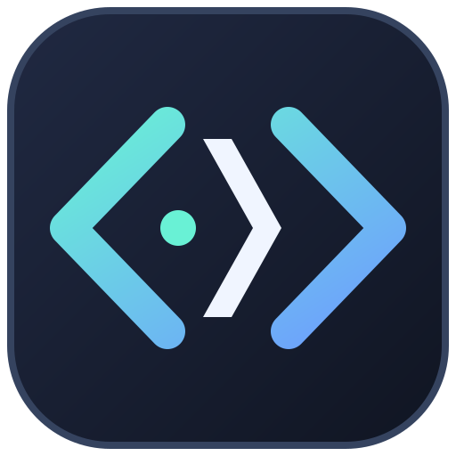
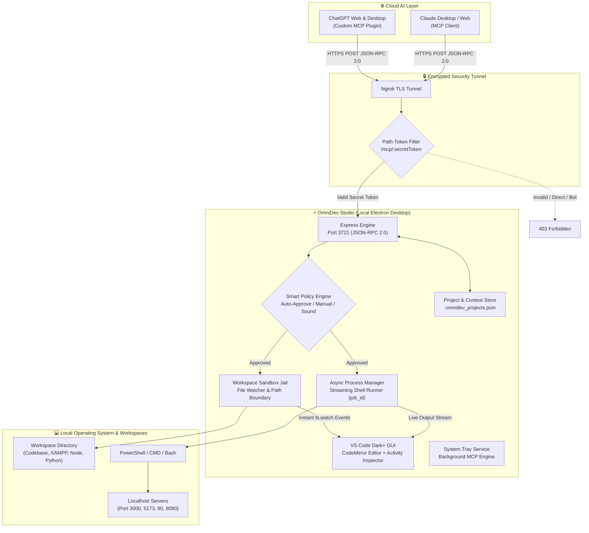

<div align="center">



# OmniDev Studio
### AI-powered desktop development workspace & MCP server

The OmniDev Studio mark combines code brackets and a terminal prompt. Its scalable SVG and Windows icon variants are generated from one source with `npm run brand:icons`.

[](https://nodejs.org/)
[](https://www.electronjs.org/)
[-007acc?style=for-the-badge)](https://modelcontextprotocol.io/)
[](https://ngrok.com/)
[](LICENSE)

**Turn ChatGPT, Claude, and any MCP-compatible AI into an autonomous local software engineer on your machine.**

[Key Features](#-key-features) • [Architecture](#-architecture) • [Getting Started](#-getting-started) • [ChatGPT Setup](#-chatgpt-custom-mcp-integration) • [Available MCP Tools](#-available-mcp-tools-25) • [Security & Sandboxing](#-security--sandboxing-model)

</div>

---

## 📖 Overview

**OmniDev Studio** is an Electron MCP server for local files, terminal commands, processes, and development servers. It offers a loopback connection for local clients and an optional ngrok HTTPS tunnel for remote clients. Both use a tokenized MCP URL.

With OmniDev Studio, AI models can inspect codebases, write and edit files surgically, run PowerShell/Bash commands, execute background servers, manage Git repositories, and document project architecture automatically.

---

## 🏗️ Architecture



---

## ✨ Key Features

### 1. 🎨 Visual Studio Code Dark+ Interface
- **Frameless Custom Control Bar:** Native look-and-feel with integrated Minimize, Maximize/Restore, and Close buttons.
- **System Tray Integration:** Choose to minimize to system tray on close so ChatGPT can continue working in the background uninterrupted.
- **Draggable & Resizable Panels:** Fully custom layout with draggable horizontal and vertical resizers for the bottom panel, left sidebar, and activity sub-sections.
- **Matching Custom Scrollbars:** Unified dark `#424242` scrollbars with cyan/blue accents matching the VS Code theme.

### 2. ⚡ 25+ Full-Stack Local Development Tools
Provides comprehensive filesystem manipulations, PowerShell/CMD runners, Git control, process management, port diagnostic checkers, and HTTP fetching out of the box.

### 3. 🧠 Self-Documenting Project Context (`update_project_context`)
When connecting to a new workspace, if environment context or developer notes are missing, AI agents can inspect the codebase and call `update_project_context` to document:
- Framework & tech stack
- Localhost URL (e.g., XAMPP Apache, Vite, Next.js)
- Database credentials & ports (MySQL, Postgres, SQLite)
- Architectural conventions and key directories
*Saved permanently in `.omnidev_projects.json` and passed to the AI in subsequent connections.*

### 4. 🚀 Asynchronous Process Manager with Job IDs
- Every command invoked via `run_command` receives a unique tracking ID (`job-xxxxxxxx`).
- Long-running processes (e.g., `npm run dev`, `python manage.py runserver`, `docker compose up`) stream stdout/stderr in real time to the app terminal.
- One-click **"✕ Terminate Process"** button in both the Live Inspector and bottom terminal.
- AI can check job progress or retrieve accumulated logs at any time via `get_job_status`.

### 5. 🔍 Real-Time Live Activity & Process Inspector
- Click any activity or process in the sidebar or bottom execution table to inspect full details:
  - Formatted JSON input parameters with a **Copy** button.
  - Formatted execution output logs with a **Copy Output** button.
  - Duration (in ms) and execution timestamp.

### 6. 📁 Instant File Watcher
- Powered by native recursive `fs.watch` with debouncing.
- Whenever AI creates, edits, or deletes a file (or external code generators run), the Explorer tree refreshes instantly without needing a manual refresh.

### 7. 🔐 Multi-Tier Security & Sandbox Model
- **Secret Path-Based Token:** Only the client with your unique URL (`/mcp/sec_...`) can access the server. Direct probes to `/` or unauthorized paths return `403 Forbidden`.
- **Directory Jailing:** AI tools are locked inside the active workspace folder. Attempts to access parent paths (`../`) are blocked unless explicitly configured in settings.
- **Smart Permission Engine:**
  - **Smart Protection (Recommended):** Safe read operations are auto-approved; shell commands and file mutations trigger an interactive prompt with audio chime.
  - **Full Autonomous:** Zero-friction automated development.
  - **Strict Manual:** Every single action requires user confirmation.

---

## 🚀 Getting Started

### Prerequisites
- **Node.js**: v18.0.0 or higher
- **npm** or **pnpm**
- **Git**

### Installation

1. **Clone the repository:**
   ```bash
   git clone https://github.com/AdiKhanOfficial/omnidev-studio.git
   cd omnidev-studio
   ```

2. **Install dependencies:**
   ```bash
   npm install
   ```

3. **Start the application:**
   ```bash
   npm start
   ```

---

## MCP connection

Open **Settings → MCP Tunnel**. Select **Local** and click Codex, Claude Code, or Antigravity. OmniDev checks that the client is installed, updates its user config, and switches to Local in the same step. Restart the client and open a workspace in OmniDev before using its tools. To copy the endpoint without configuring a client, save Local mode first.

For remote clients, select **ngrok**, enter your ngrok authtoken, and save. When the tunnel connects, copy the HTTPS endpoint and follow the in-app instructions for ChatGPT, Claude, or Gemini CLI. Treat the URL as a credential because it contains your MCP access token.

---

## 🛠️ Available MCP Tools (70+)

| Category | Tool Name | Description |
|---|---|---|
| **Context** | `get_project_context` | Retrieves active workspace path, tech stack, and developer notes. |
| **Context** | `update_project_context` | Automatically records detected localhost URLs, database details, and architecture notes. |
| **Filesystem** | `read_file` | Reads workspace file contents with line numbers and range slicing. |
| **Filesystem** | `write_file` | Creates or overwrites files in the workspace (auto-creates directories). |
| **Filesystem** | `edit_file_replace` | Surgically replaces exact text snippets in an existing file. |
| **Filesystem** | `list_directory` | Lists directory contents recursively with depth controls. |
| **Filesystem** | `search_code` | Performs regex or literal text searches across the workspace. |
| **Filesystem** | `delete_file` | Safely deletes a file or directory inside the workspace. |
| **Filesystem** | `get_file_info` | Retrieves file metadata (size, created, modified). |
| **Terminal** | `run_command` | Executes PowerShell/Bash commands with streaming output and assigns a `job_id`. |
| **Terminal** | `get_job_status` | Checks exit status, duration, and output of a running or completed command. |
| **Terminal** | `cancel_job` | Terminates an active background process by `job_id`. |
| **Git** | `git_status` | Returns active branch, staged files, untracked changes, and commit status. |
| **Git** | `git_diff` | Retrieves git diff of unstaged or staged modifications. |
| **Git** | `git_commit` | Stages changes and creates a commit with a message. |
| **Git** | `git_log` | Inspects recent commit history with hashes, authors, and timestamps. |
| **Git** | `git_branch` | Lists, creates, or switches git branches. |
| **System** | `get_system_info` | Reports OS, CPU architecture, free RAM, and Node version. |
| **System** | `check_port` | Checks if local TCP ports (e.g., 3000, 80, 3306, 8080) are available. |
| **System** | `fetch_http` | Sends HTTP requests to test local development servers or APIs. |
| **System** | `list_processes` | Lists running OS processes (name, PID, memory), with optional filter. |
| **System** | `kill_process` | Terminates a process by PID or image name (e.g. a stuck dev server). |
| **System** | `read_env` | Reads a `.env` file; secret-looking values hidden unless `reveal: true`. |
| **System** | `notify_user` | Sends a desktop notification to the developer. |
| **Filesystem** | `edit_file_multi` | Applies several surgical find/replace edits to one file atomically. |
| **Filesystem** | `move_file` / `copy_file` | Move/rename or copy files & folders inside the workspace. |
| **Filesystem** | `list_backups` / `restore_backup` | Browse and roll back automatic pre-edit snapshots. |
| **MySQL** | `mysql_query` | Runs SQL against MySQL/MariaDB (XAMPP) via the `mysql` CLI. |
| **MySQL** | `mysql_databases` / `mysql_schema` | List databases, tables, and DESCRIBE a table. |

> Plus a full **reverse-engineering suite** (`strings_extract`, `hex_dump`, `pe_info`, `elf_info`, `xor_bruteforce`, `yara_scan`, `disassemble_bytes`, `run_r2`, …), **APK / JAR / .NET rebuild** tools (`apk_decode`, `apk_rebuild`, `apk_sign`, `jadx_decompile`, `dotnet_decompile`, `smali_patch`, `patch_binary`, …), and **headless browser** tools (`take_screenshot`, `get_page_text`, `get_page_console_errors`, `click_element`). The live tool count is reported to the AI on every connection.

---

## 🧩 Custom Skills & Plugins

OmniDev is fully extensible. Drop a `.js` file in the `plugins/` folder (or click **＋ New skill** in the Skills pane to scaffold one) and it is auto-discovered, hot-reloaded, and exposed to the AI as a new MCP tool — no restart.

```js
module.exports = {
  name: 'deploy_staging',                   // required — snake_case tool name
  description: 'Deploy the app to staging', // required — the AI reads this
  handler: async (params, ctx) => {         // required — ctx.config = user settings
    return { ok: true };
  },

  // Optional manifest (shown in the Skills pane):
  version: '1.0.0',
  author: 'you',
  category: 'Deploy',
  isCritical: true,                         // require approval before each run
  inputSchema: { type: 'object', properties: { /* … */ } },
  configSchema: [                           // user-editable settings
    { key: 'api_base', label: 'API base URL', type: 'string', default: '' }
  ]
};
```

Each skill can be **enabled/disabled** and **configured** from the Skills pane; disabled skills are hidden from the AI. Per-skill config is passed to the handler as `ctx.config`.

---

## 🖥️ Interface (v2)

- **Skills & Plugins pane** — cards with enable/disable toggles, per-skill config, a "New skill" generator, and the plugins folder shortcut.
- **Tools & Permissions pane** — searchable catalog of every registered tool with a per-tool **permission matrix** (Default / Auto / Ask / Deny) that overrides the global mode.
- **Audit History pane** — a persistent, timestamped log of every tool call (success/failure + duration), written to `.omnidev/audit.log`.
- **Diff-preview approvals** — file writes/edits show an inline red/green diff in the approval strip before you approve.
- **Command palette** — press <kbd>Ctrl</kbd>+<kbd>K</kbd> to jump to any pane, action, or tool.
- **Automatic backups** — every overwrite, surgical edit, and delete snapshots the file to `.omnidev/backups/` first, so changes are reversible via `restore_backup`.
- **Themes** — Midnight, Graphite, Ocean, and Light (cycle with the Theme button).

---

## ⚙️ Configuration & Storage

OmniDev Studio maintains its configuration locally in the working directory:
- `.omnidev_settings.json`: Stores tunnel settings, Ngrok authtoken, static domain, active secret token, permission mode, theme, and the per-tool permission matrix.
- `.omnidev_projects.json`: Stores workspace paths, project names, tech stack tags, and developer environment notes.
- `.omnidev/plugins.json`: Stores which skills are disabled and their per-skill config.
- `.omnidev/audit.log`: Append-only JSONL audit trail of every tool call.
- `.omnidev/backups/`: Automatic pre-edit file snapshots for rollback.

---

## 📦 Building the Desktop Executable

Run these commands on Windows after installing dependencies with `npm ci`.

```bash
npm run build           # Windows setup installer (also npm run build:win)
npm run build:portable  # Standalone portable Windows executable
```

Both options write branded executables to `dist/` and use the installed Electron runtime for the build machine’s architecture. The setup wizard lets you choose the installation folder and creates Start menu and desktop shortcuts. Desktop builds store settings and workspace history in Electron’s per-user data folder. Add your own ngrok credentials in Settings if you want a public MCP connection.

Electron Builder fetches its Windows packaging tools on the first build. For an offline build with an existing NSIS toolchain, set `ELECTRON_BUILDER_NSIS_DIR` and `ELECTRON_BUILDER_NSIS_RESOURCES_DIR` to the local NSIS and NSIS resources directories.

---

## 📄 License

This project is licensed under the **MIT License** - see the [LICENSE](LICENSE) file for details.
